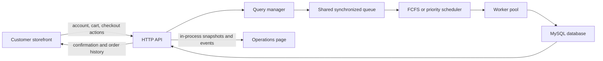
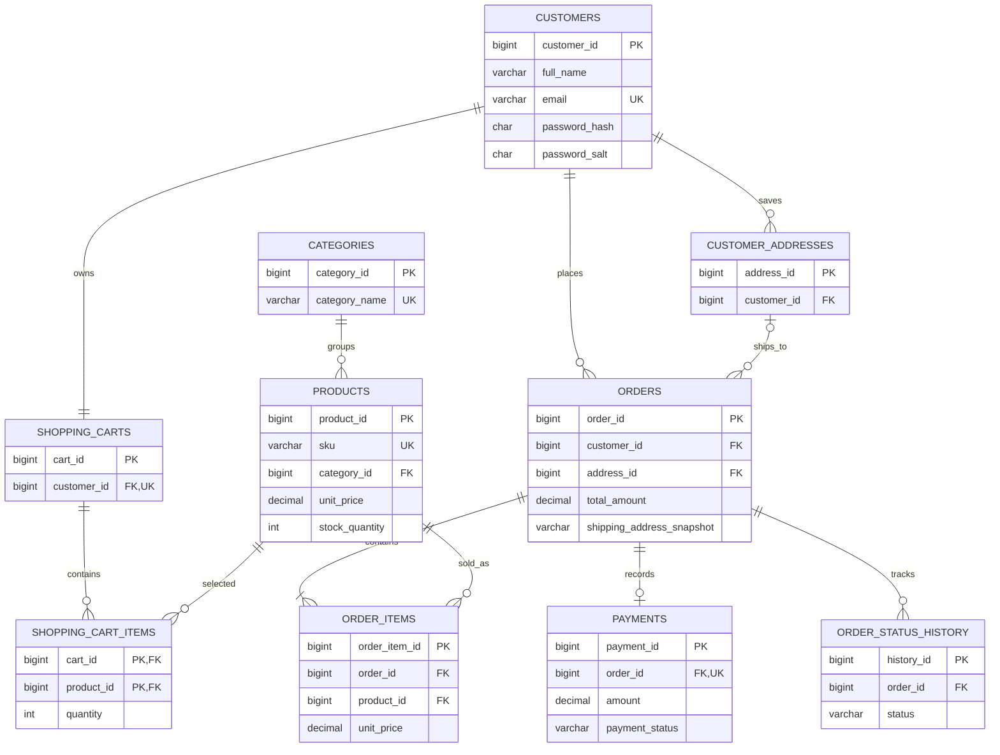

# QueryFlow

QueryFlow is a C++17 concurrent query-processing engine with a local shopping
application. Customers can create accounts, browse products, keep a database-
backed cart, place simulated orders, and see order confirmations and history.
An independent operations page visualizes how customer actions pass through
the query manager, shared queue, scheduler, worker threads, and MySQL.

The application binds to `127.0.0.1`. It is designed for local development and
classroom use, not public internet deployment. Payments are simulated.

## Run the application

The one-command path expects CMake, a C++17 compiler, Boost 1.74+, nlohmann
JSON, OpenSSL development files, MySQL 8.0 server/client tools, and MySQL
Connector/C++ to be installed:

```bash
make project
```

This initializes the local MySQL instance, applies the schema and sample
catalog, builds the MySQL-enabled application in `build-project/`, and starts
two web listeners:

- Customer storefront on port `8080`: <http://127.0.0.1:8080/>
- Admin monitor on port `8081`, on this computer only: <http://127.0.0.1:8081/>

The storefront listens on all network interfaces so other devices on the same
LAN can open it. On each device, use `http://<this-computer-LAN-IP>:8080/`
(find the computer's address with `hostname -I`). All devices share the same
MySQL-backed catalog and can submit requests concurrently; their work appears
in the admin monitor. Only open port 8080 on a trusted local network. The admin
port is deliberately bound to loopback and cannot be reached from other
devices.

Stop the server with Ctrl+C. Stop the local database separately with
`make db-stop`. Database defaults are stored in the generated `.env` file.
Override them with `QUERYFLOW_DB_*` environment variables; the database name
defaults to `queryflow`.
To choose different web ports, run `make project STOREFRONT_PORT=8090
ADMIN_PORT=8091`.

The `build-project` directory is separate from other CMake build directories,
so a stale cache from another checkout will not affect this command. To use
the mock backend instead of MySQL for engine development:

```bash
make
make test
./build/QueryFlow --backend mock --web --host 0.0.0.0
```

The mock backend does not persist accounts or orders and is not the normal
storefront path. MySQL support requires the Connector/C++ library and is built
separately:

```bash
make db-setup
make build-mysql
./build-mysql/QueryFlow --backend mysql --web
```

Use `./build/QueryFlow --help` for CLI and batch options.

## Application flow



The browser sends typed business actions, not SQL. The API maps those actions
to fixed SQL statements and prepared-statement parameters. QueryFlow assigns
work IDs, schedules requests, and executes them with a bounded worker pool.
Commerce records are persistent in MySQL; queue state, worker state, metrics,
and lifecycle events are in memory and reset when the application stops.

The operations page is an unauthenticated local engineering view. Do not bind
the service to a public interface or expose it to untrusted networks.

## Data model

`customer_id` is the primary key for customer-owned data and is used as the
foreign key in carts, addresses, and orders. Order items preserve the product
name and unit price at purchase time so catalog edits do not rewrite receipts.



The schema is in [database/schema.sql](./database/schema.sql) and starter
catalog data is in [database/seed.sql](./database/seed.sql). Checkout is a
single transaction that verifies inventory, decrements stock, saves the order,
items, simulated payment and status history, and empties the cart.

## Engine capabilities

- Thread-safe producer/consumer queue and bounded reusable worker threads.
- Priority scheduling with FCFS tie-breaking and a separate FCFS policy.
- Query snapshots, lifecycle events, worker state, and execution metrics.
- Mock backend for engine tests and optional MySQL Connector/C++ execution.
- CLI SQL workload mode with log/CSV reports.
- Browser UI served by the C++ HTTP API; user actions go through
  `QueryManager`.

## Local limitations

- Passwords are hashed with PBKDF2-HMAC-SHA256; session tokens are held in
  server memory and expire when the process restarts.
- Checkout records a simulated payment only; no real payment provider is used.
- The operations page has no authentication and is suitable only on loopback.
- Engine telemetry is not written to durable storage; the database
  `query_execution_log` table is a schema extension, not currently populated
  by the in-memory engine.
- This project is not configured for production hosting, TLS, public
  authentication, deployment, or operational monitoring.

## Team

- Harshita Aggarwal — Core Engine & Integration
- Disha Suthar — Concurrency & Worker System
- Sakshi Tiwari — Scheduling & Performance
- Tanisha Pokhriyal — Database & SQL

See [docs/TEAM_MODULE_GUIDE.md](./docs/TEAM_MODULE_GUIDE.md) and
[docs/PROJECT_STRUCTURE_AND_LEARNING_GUIDE.md](./docs/PROJECT_STRUCTURE_AND_LEARNING_GUIDE.md)
for the codebase learning guide.
