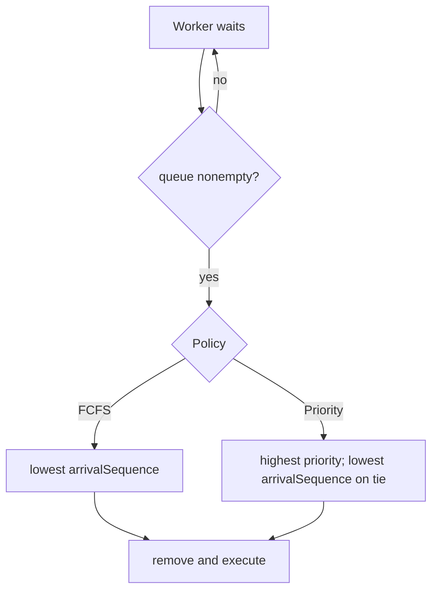

# Backend workflow

## Manager and lifecycle

`QueryManager::submit` rejects blank SQL and submissions after shutdown. Under its mutex it assigns `nextId_` and `nextArrivalSequence_`, builds an initially `queued` `QuerySnapshot`, pushes the `Query` to `SharedQueryQueue`, and appends `query.received`, `query.id_assigned`, and `query.queued` events. Statuses are only `queued`, `running`, `completed`, and `failed`.

The worker start callback sets status to `running`, assigns `worker-N`, and records `query.scheduled`, `worker.started`, and `database.started`. Completion copies result columns, rows and optional affected rows, sets terminal state, clears the worker assignment, and emits database/query completed or failed events.

## Queue and scheduling

`SharedQueryQueue` is a `std::vector<Query>` protected by a mutex. `push` appends and calls `notify_one`; `waitAndPop` waits with a predicate until work exists or stopping is requested. It calls `Scheduler::selectNext`, moves out the selected element, then erases it. `orderedQueries` repeatedly applies the exact same scheduler to a copy, which makes the API queue ordering represent actual future dispatch order.

No aging exists, so lower priorities can starve during sustained higher-priority arrivals. No worker can preempt a query that has already left the queue.

## Worker pool and shutdown

The constructor rejects zero workers. `start` creates the configured number of `std::thread`s. Each gets a stable index from `nextWorkerId_`, loops over `waitAndPop`, catches database exceptions, and invokes completion callback. `shutdown` requests queue stop, wakes all waiters, then joins all worker threads. Jobs already popped may finish before joining completes.

## Database modes

`MockDatabaseManager` sleeps for simulated latency (2 ms CLI default; 40 ms web default unless overridden), records executed IDs under a mutex, and does not execute SQL. `DatabaseManager` is compiled only with `QUERYFLOW_WITH_MYSQL`. It owns a map from `std::thread::id` to a `db::Database`, so each worker lazily gets its own connection. It converts MySQL rows and `NULL`s into `DatabaseResult`; exceptions propagate to the worker and become `failed` snapshots.

The lower `db::Database` adapter uses Connector/C++ statements for trusted SQL, prepared statements for supplied parameters, and supports explicit transactions. The manager itself currently calls only `execute(query.sql)` and does not persist lifecycle records to `query_execution_log`.
