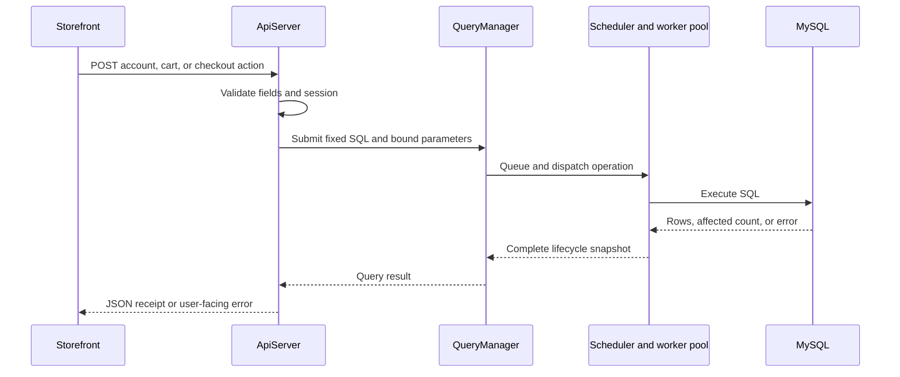

# Frontend architecture

The web UI is served as static HTML, CSS, and JavaScript by the C++ HTTP API.
The customer storefront is on port 8080 and the separate operations monitor
uses port 8081. The storefront listener can bind to the local network for
multiple devices; the admin listener is bound only to `127.0.0.1`. Both
listeners use the same API implementation and engine state, but each exposes
only its own routes. The storefront is not a query console: it presents
account, catalog, cart, checkout, receipt, and order-history actions.

## Customer storefront

Customers register or sign in with an email and password. The API stores
PBKDF2-HMAC-SHA256 password hashes and random salts in MySQL. The server issues
a random bearer token and keeps its token-to-customer mapping in process
memory. The browser stores that token in local storage and sends it in the
`X-QueryFlow-Session` header. Restarting the process expires active sessions.

Catalog, cart, checkout, and order-history requests are mapped by the server to
fixed SQL statements. Values supplied by the browser are passed as prepared
statement parameters. The client never submits SQL or scheduler priority.
Checkout creates the address, order, order items, simulated payment and order
history record in one MySQL transaction, updates stock, and empties the cart.

## Operations page

`admin.html` and `admin.js` poll the local API for query snapshots, queue
ordering, workers, lifecycle events, and aggregate metrics. The page shows the
application path and current engine activity; it is not a secured
administrative portal. The API binds to loopback only by default.

Engine snapshots, metrics, and lifecycle events exist only in process memory.
They are lost on restart. The `query_execution_log` table is not currently
populated by the engine.

Non-2xx API responses include a JSON error message. The storefront reports
those errors in its relevant feedback area. The operations page marks
connection failures instead of fabricating data.
