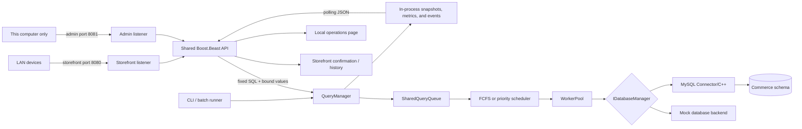
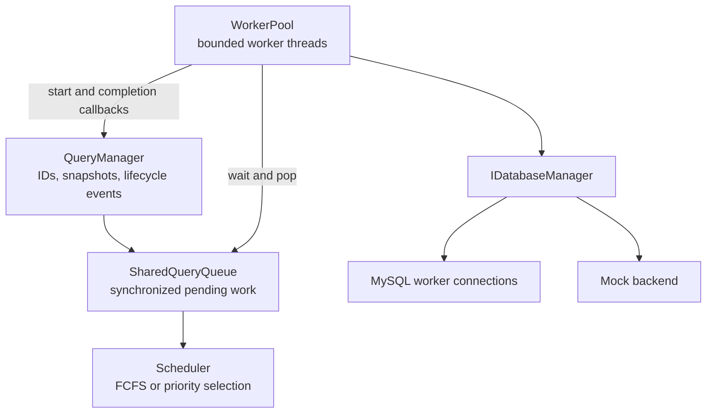

# System architecture

Customer actions are validated and translated into fixed parameterized SQL by
`ApiServer`. They do not submit arbitrary SQL or choose priority. The checkout
operation uses a database transaction to persist order-related records and
update inventory. Query status, worker assignments, metrics, and lifecycle
events are currently process-local; they are not stored in
`query_execution_log`.

| Component | Responsibility |
|---|---|
| ApiServer | Validates storefront requests, binds user values, and serializes results |
| QueryManager | Assigns IDs, tracks lifecycle snapshots/events, and submits jobs |
| SharedQueryQueue | Synchronizes producer submissions and worker consumption |
| Scheduler | Chooses the next queued operation by configured policy |
| WorkerPool | Executes operations using a bounded set of threads |
| Database manager | Uses MySQL connections or the mock implementation |
| Storefront | Account, catalog, cart, checkout, receipt, and order history |
| Operations UI | Visualizes live in-memory queue, workers, events, and metrics |

The storefront listens on the configured host (the `make project` target uses
`0.0.0.0`) and is reachable to devices on the trusted LAN. The admin listener
uses `127.0.0.1` on its separate port, so it remains accessible only from the
server computer. Both listeners share one `QueryManager`, worker pool, and
MySQL connection configuration; simultaneous client requests enter the same
scheduled queue. The admin UI is unauthenticated and must not be rebound to a
network interface.
